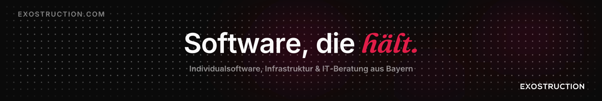

**Custom Software · Web · Automation**

We build software, websites, and IT infrastructure tailored to your business, from the first idea to ongoing operation.

[Website](https://exostruction.com) · [Contact](mailto:hello@exostruction.com)

---

## What we do

| Area | What it covers |
|---|---|
| **Software and web apps** | Custom software, web applications, integrations, and automation |
| **Websites** | For small businesses and non-profits, with hosting and ongoing maintenance on request |
| **Security** | Security checks, server hardening, patching, and advice |
| **Operations** | Maintenance, monitoring, and backups |

Based in Regenstauf, Upper Palatinate, Germany. We focus on small and medium-sized businesses, non-profits, and freelancers, primarily in the Regensburg area.

## Open source

| Project | Description |
|---|---|
| [**Exoseal**](https://github.com/Exostruction/Exoseal) | Self-hostable software for sharing secrets once, end-to-end encrypted. TypeScript, AGPL-3.0. |

## Recent activity

Updated automatically every few hours from the public repositories of this organization.

### Latest pushes

<!--ACTIVITY:START-->
No data yet. The workflow fills this in on its first run.
<!--ACTIVITY:END-->

### Recently active repositories

<!--REPOS:START-->
No data yet.
<!--REPOS:END-->

---

Exostruction GmbH · Bayernstraße 16 · 93128 Regenstauf, Germany · [exostruction.com](https://exostruction.com)

